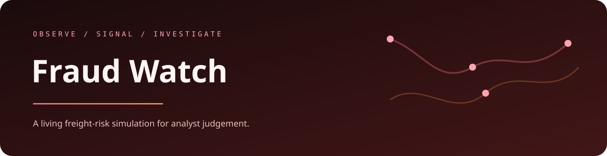
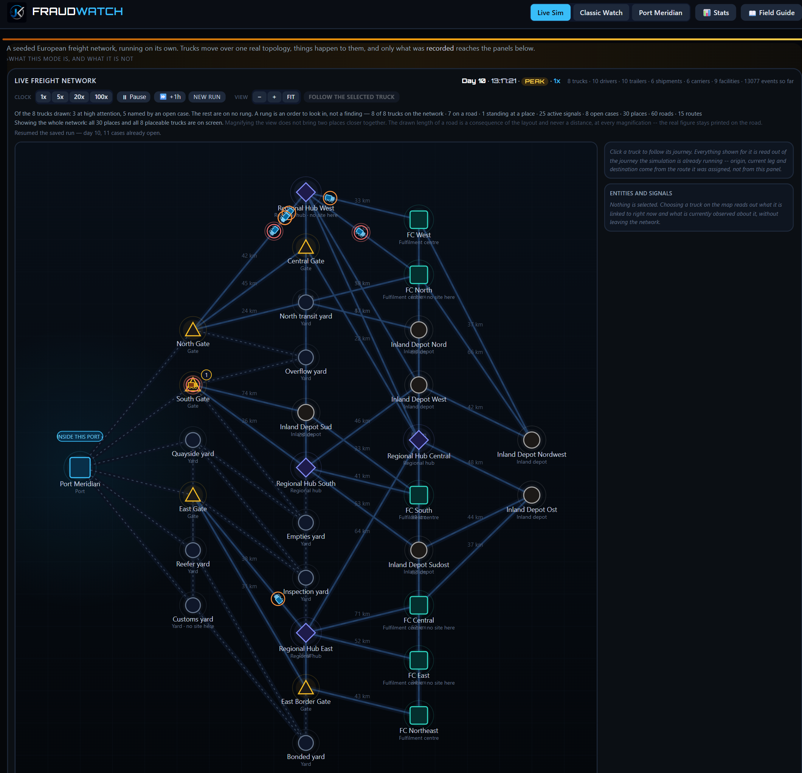
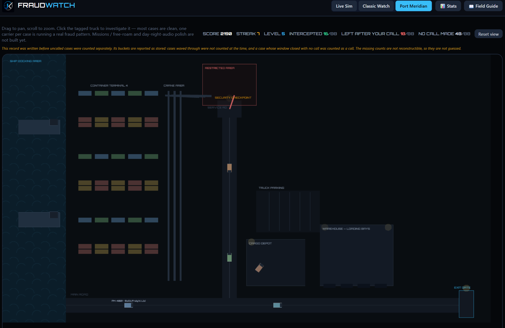
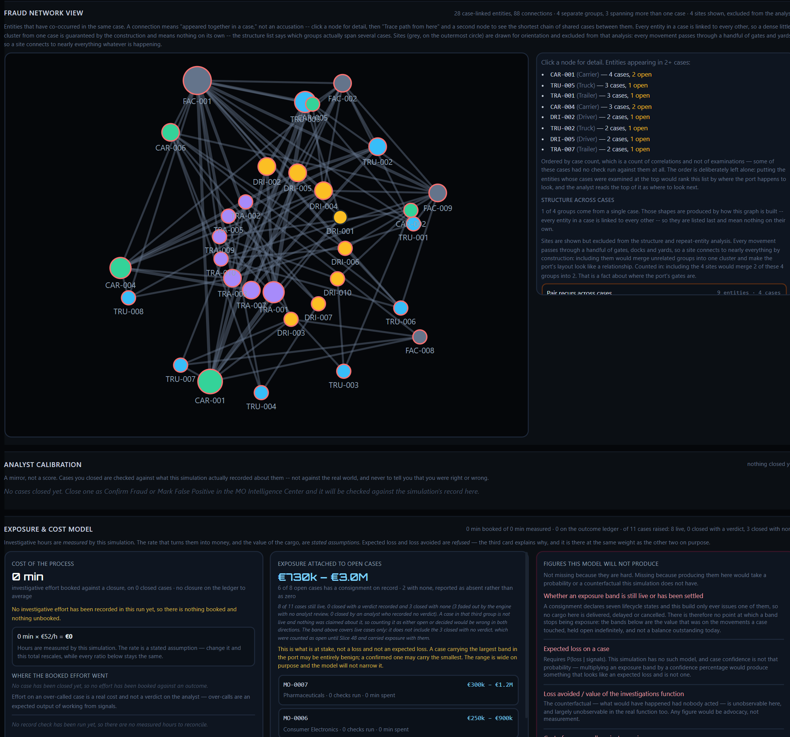

<p align="center">
  
</p>

<p align="center">
  <a href="https://jeevan-0508.github.io/fraud-watch/">Play the live simulation</a> ·
  <a href="#watch-the-world-change">Watch the world change</a> ·
  <a href="#run-locally">Run locally</a>
</p>

# Fraud Watch

### Observable behaviour → signals → investigation.

Fraud Watch is a synthetic freight world for practising analyst judgement. Trucks move, routes evolve, signals accumulate, and investigations compete with benign explanations. The analyst sees the evidence—not the hidden ground truth.

`SYNTHETIC WORLD` · `DETERMINISTIC SIMULATION` · `ANALYST REVIEW` · `NO BUILD STEP`

## Start with the simulation

**[Play Fraud Watch →](https://jeevan-0508.github.io/fraud-watch/)**

Follow a movement from observable behaviour to a suspicious signal, open the investigation, and decide what you would do next. The point is not to “win” the simulation; it is to practise distinguishing a useful signal from an overconfident story.

## Watch the world change

<p align="center"></p>

<table>
  <tr>
    <td width="50%"><br><strong>Observe the scene</strong><br>Start with the movement, the route, and the operational context.</td>
    <td width="50%"><br><strong>Follow the network</strong><br>Connect entities and signals without losing the human review step.</td>
  </tr>
</table>

## Why it matters

Fraud work is not only about finding patterns. It is about deciding whether the pattern is strong enough to act on, what innocent explanation remains possible, and which next observation would reduce uncertainty.

<details>
<summary><strong>Scope and limitations</strong></summary>

This is a deterministic simulation with synthetic entities and events. It does not model real carriers, real people, or live operational data, and it should not be used as a detection service.

</details>

## Run locally

No build step is required. Serve the repository with any static file server:

```bash
python3 -m http.server 4173
```

## Related systems

[Freight Risk Atlas](https://github.com/Jeevan-0508/freight-risk-atlas) · [Freight Fraud Taxonomy](https://github.com/Jeevan-0508/freight-fraud-taxonomy) · [RISK//MESH](https://github.com/Jeevan-0508/Risk-Mesh)

<p align="center"><sub>Built by <a href="https://github.com/Jeevan-0508">Jeevan Siddhabhaktula</a> · MIT licensed</sub></p>
